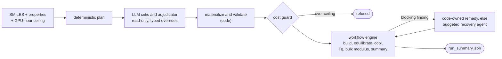

# PolyJarvis

[](https://github.com/arz-2/PolyJarvis/actions/workflows/tests.yml)
[](https://arxiv.org/abs/2604.02537)

PolyJarvis runs all-atom molecular dynamics of amorphous polymers end to end: from a
repeat-unit SMILES to an EMC-built amorphous cell, LAMMPS equilibration on a GPU
workstation, and properties (density, glass transition temperature, bulk modulus). Control is split deliberately. Code owns every
simulation file, parameter, job, validation gate, retry budget and provenance record; a
language model makes a small number of typed, bounded decisions (a force-field critique, a
plan adjudication, and diagnosis of failures that no code-owned remedy covers), and the
whole pipeline also runs with no model at all.

## How it works



The design, including exactly what a model may and may not decide, every validation gate,
and the recovery budgets, is in [docs/architecture.md](docs/architecture.md).

## Quickstart (no GPU, no LAMMPS, no API key)

Requires Python 3.11 and [uv](https://docs.astral.sh/uv/).

```bash
git clone https://github.com/arz-2/PolyJarvis && cd PolyJarvis
uv sync --locked                                   # exact versions from uv.lock
export POLYJARVIS_MOL_PYTHON="$PWD/.venv/bin/python"  # run RDKit steps in this env
```

Without uv: `python3.11 -m venv .venv && .venv/bin/pip install -r requirements-test.txt`
(the same pins, exported from the lock), then use `.venv/bin/python` and `.venv/bin/pytest`
in place of `uv run python` and `uv run pytest` below.

### 1. Run the test suite

```bash
uv run pytest
```

```text
2199 passed, 44 skipped, 33 deselected, 2 xpassed in 214.94s (0:03:34)
```

Tests that need EMC, LAMMPS or RadonPy are marked `requires_binaries` and skipped by
default. `tests/test_control_plane_guardrails.py` is the shortest tour of the agent
guardrails.

### 2. Replay a captured plan

Validate an already-adjudicated polystyrene plan and resolve every stage into concrete
engine arguments, without submitting anything:

```bash
uv run python orchestration/scripts/scientific_control.py \
  --run-name PS_replay --goal 'density, Tg and bulk modulus at 300 K' \
  --smiles '*CC(*)c1ccccc1' --properties density,tg,bulk_modulus \
  --plan examples/pstr_run_plan.json --dry-run
```

The output is one JSON document ending in `"status": "complete"` and
`"recovery_agent_calls": 0`; under `result` are the resolved arguments for each of the
eleven stage calls (`build`, `equil`, `equil-check`, `cool`, `cool-check`, `tg`,
`analyze-tg`, `murnaghan`, `deform`, `analyze-bm`, `run-summary`).

### 3. From SMILES to a priced plan, headless and with no model

```bash
uv run python orchestration/langgraph/run_graph.py \
  --run-name PE_demo --smiles '*CC*' --properties density,tg \
  --goal 'density and Tg for polyethylene' \
  --max-gpu-hours 40 --deadline-hours 24 --no-llm --dry-run
```

It streams one JSON event per graph node (shortened here):

```text
{"event": "cache_probe", "hit": true}
{"event": "plan", "plan_mode": "deterministic", "confidence": "high", "gpu_hours": 1.6988}
{"event": "cost_admitted", "gpu_hours": 1.6988, "ceiling": 40.0, "note": "total_gpu_hours is a LOWER bound; ..."}
{"event": "execute", "skipped": true, "note": "--dry-run"}
{"event": "done", "status": "accepted", "exit_code": 0, ...}
```

Lower the ceiling below the estimate (`--max-gpu-hours 1`) and the cost guard refuses
before anything runs:

```text
{"event": "stop", "status": "cost_exceeded", "detail": "priced work is 1.70 GPU-hours against a ceiling of 1.00. This is a LOWER bound -- 1 stage(s) are unpriced -- so the real cost is higher, not lower."}
{"event": "done", "status": "cost_exceeded", "exit_code": 5, ...}
```

Both runs write their plan to `data/<run-name>/raw/run_plan.json`. A
SMILES not in `guides/system_characterization_cache.json` must first be classified, which
needs RadonPy, so this demo uses a cached polymer.

## Running real campaigns

Real runs happen on a GPU workstation with LAMMPS (optionally built with KOKKOS), EMC, and
the RadonPy and RDKit conda environments in `env/`. Install the MCP servers' dependencies
from `mcp-servers/requirements.txt`, copy `.mcp.json.example` to `.mcp.json` and fill in
the host paths, and calibrate the host's cost model:

```bash
python3 hardware/calibrate_hardware.py --dry-run
```

Then drop `--dry-run` from the command above; drop `--no-llm` as well to enable the
literature critic, the adjudicator and the recovery agent, which run as headless
`claude -p` calls. A run that stops early resumes from `data/<run>/` with the same command.

| Exit code | Status | Meaning |
|---|---|---|
| 0 | `accepted` | Every stage passed its gates |
| 2 | `escalation_required` | A finding needs a decision and no agent is configured (`--no-llm`) |
| 3 | `failed` | Ended by the engine or the agent; `workflow_state.json` records `terminated_by` |
| 4 | `deadline_exceeded` | Wall-clock deadline reached; resumable |
| 5 | `cost_exceeded`, `cost_unknown` | Refused by the cost guard |
| 6 | `classify_error`, `plan_error`, `materialize_error` | Could not produce a valid plan |
| 7 | `d01_refusal` | No force field types this repeat unit |
| 8 | `locked` | Another process holds this run |

## Repository layout

| Path | Contents |
|---|---|
| `orchestration/scripts/` | The control plane: planning, validation, parameter resolution, the workflow engine and its remedies, cost and hardware policy. [Module index](orchestration/README.md). |
| `orchestration/langgraph/` | The headless driver: topology only, holding no state of its own |
| `mcp-servers/` | EMC builder, LAMMPS engine (templates, launch, analysis) and molecule-builder servers |
| `guides/` | Machine-readable policy: polymer classes, force-field rules, functional groups |
| `tests/` | The pure-logic suite (default `pytest` selection) |
| `benchmarks/`, `manuscript/gen/` | Evaluation harnesses and the generators behind every number in the paper |
| `data/` | Per-run workspaces; the runs reported in the paper are committed here |

## Earlier multi-agent version

Before this design, PolyJarvis ran as a team of 16 cooperating stage agents, each driven
by a worker prompt. That version is preserved at the
[`v1-multi-agent`](https://github.com/arz-2/PolyJarvis/tree/v1-multi-agent) tag;
[docs/architecture.md](docs/architecture.md#why-this-design) explains what changed and why.

## Citation

```bibtex
@misc{zhao2026polyjarvis,
  title         = {PolyJarvis: An LLM-Orchestrated Agent for Automated All-Atom Molecular
                   Dynamics of Amorphous Homopolymers},
  author        = {Zhao, Alexander and Chandrasekhar, Achuth and Barati Farimani, Amir},
  year          = {2026},
  eprint        = {2604.02537},
  archivePrefix = {arXiv},
  primaryClass  = {cs.CL},
  url           = {https://arxiv.org/abs/2604.02537}
}
```

GitHub's "Cite this repository" button reads the same metadata from `CITATION.cff`.

## License

MIT. See [LICENSE](LICENSE).
