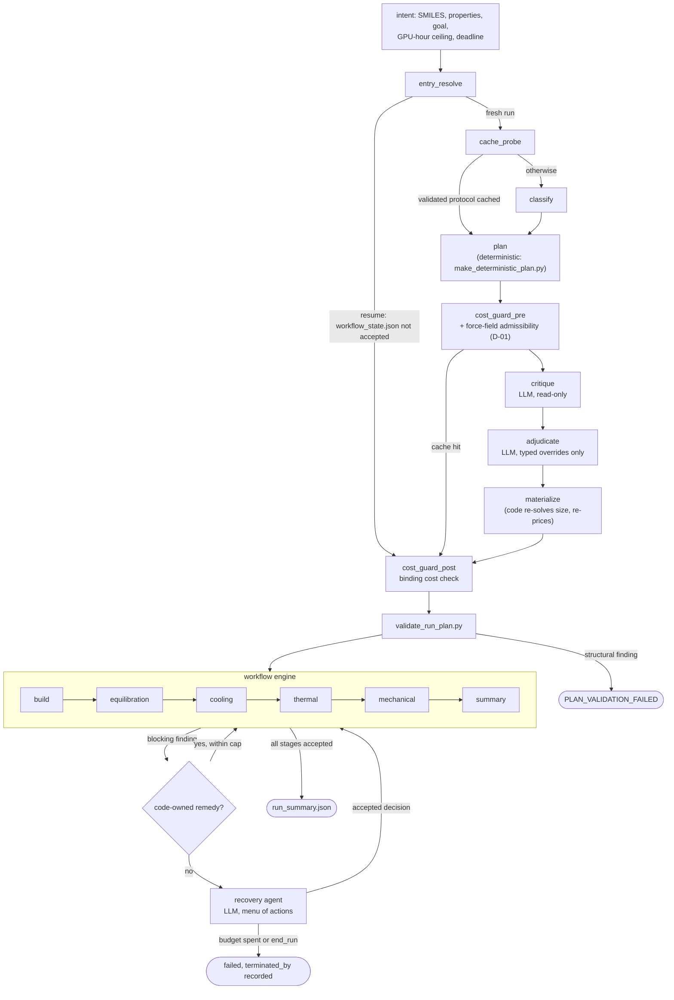

# Architecture

PolyJarvis turns a repeat-unit SMILES and a list of target properties into a finished
all-atom MD campaign: an amorphous cell built with EMC, equilibrated and analyzed in LAMMPS,
and graded against experimental reference bands. This document describes how control is
divided between code and language models, and why.

The rule, in one line: **models make bounded, typed decisions; code owns every file,
parameter, job, gate, budget and record.**

## The run, end to end

Any guard can also stop the graph (cost exceeded, unpriced plan, D-01 refusal, deadline);
those edges go straight to the end and are left out of the diagram, as are the optional
`structure` and `cohesive` stages, which run only when requested. The graph
(`orchestration/langgraph/graph.py`) is a DAG: no edge leads back, so a terminal status is
never re-entered after the engine's budget is already spent.

## What a model may decide, and what it may not

There are three model touchpoints. None of them can write a file, submit a job, claim a GPU,
or reach the simulation engines.

| Touchpoint | May decide | Bounded by |
|---|---|---|
| **Literature critic** (`critique` node) | An agree/disagree verdict on the force field, with per-study evidence | Advisory only. Its output is a record; a failed call proceeds without it. |
| **Adjudicator** (`adjudicate` node) or the planning agent behind `scientific_control.py` | Polymer class, properties, rationale, and overrides of scientific knobs | `planning_parameter_contract()`: 71 named parameters, each typed with a range, enum or shape. Anything else is rejected by `validate_overrides()`. |
| **Recovery agent** (`recovery_agent_cli.py`) | One action from the menu the engine offers for this failure, optionally with parameter modifications | The same parameter contract, plus the decision budgets below. |

The menu the engine offers on an escalation is `registered_remedy`, `retry`,
`wait_and_retry`, `revise_plan`, `end_run`, and `accept_with_caveat`. The last is offered
only on the `thermal` and `mechanical` property gates and only when the attempt produced
artifacts, because accepting there withdraws one reported number rather than hiding a broken
cell.

What a model may **not** do, and where that is enforced:

- **Write files.** The headless calls (`orchestration/scripts/headless_claude.py`) never
  include Write or Edit in their allowed tools, and run with `--strict-mcp-config` and no MCP
  config, so they have zero MCP servers. Python writes every artifact from the returned
  structured output.
- **Change paths, commands or runtime wiring.** Those keys are not in the parameter
  contract; `test_recovery_agent_cannot_modify_paths_or_commands` pins this.
- **Pick a stage order, skip a gate, or mark a stage accepted.** Stage order and acceptance
  belong to `WorkflowEngine`; a model only ever returns a decision object.
- **Spend without limit.** Each headless call carries a USD cap and a timeout (critic $3 and
  30 min, adjudicator $6 and 15 min), and `JsonSubprocessAgent` times out a wedged agent
  after `AGENT_SUBPROCESS_TIMEOUT_S`.

One property of the contract is worth stating explicitly: the overridable parameters include
the experimental reference values a run is graded against (`experimental_tg_K`,
`experimental_density_gcm3`, `exp_K_min_GPa`, `exp_K_max_GPa`), so that a literature-backed
correction to a class default can be applied. Every override is recorded in the plan.

## Validation gates

Gates are code, run on every path, and their findings are structured objects with a code
and a severity.

1. **Force-field admissibility (D-01)**, in `cost_guard_pre`, before any model spend. A
   SMILES matching a measured blocking moiety is probed with a real EMC trial build; if no
   field types it, the run is refused (`d01_refusal`) rather than defaulted.
2. **Cost**, twice. `cost_guard_pre` refuses only a plan already over the ceiling, since a
   scaffold is not priced yet. `cost_guard_post` is binding: it re-reads the plan after
   materialize and refuses an over-ceiling plan (`cost_exceeded`) or an unpriceable one
   (`cost_unknown`) unless `--allow-unpriced` is given. `total_gpu_hours` is a documented
   **lower bound**, so the guard can only ever refuse soundly, never clear a run as fitting.
   Every path into `execute` passes this guard, resume and cache hit included.
3. **Plan validation** (`validate_run_plan.py`). Policy criteria and evidence, stage schema,
   hardware, force field, system size (re-solved live, not trusted from the plan), finite-size
   limits, and unimplemented or overridden parameters. Any `structural` finding stops the run
   before the engine starts.
4. **Stage gates** inside the engine. The build is checked for zero-substituted force-field
   parameters and pre-simulation validity; equilibration must pass `enforce_gate.py`'s
   `require_melt` on the melt hold and `require_glassy`/`require_rubbery` on the assessment
   cell; property stages carry their own fit and convergence gates.

## Recovery limits

There are two layers, each with its own budget.

**Inside the engine** (`orchestration/scripts/workflow_engine.py`), per run:

| Budget | Constant | Value |
|---|---|---|
| Code-owned automatic remedies (deterministic, e.g. EXTEND a melt hold) | `MAX_AUTOMATIC_REMEDIES` | 12 |
| Recovery-agent decisions per run | `MAX_AGENT_DECISIONS` | 6 |
| Recovery-agent decisions per stage | `MAX_AGENT_DECISIONS_PER_STAGE` | 3 |
| Transient-failure retries | `TRANSIENT_RETRIES` | 2 |

A blocking finding goes to its registered code-owned remedy first. Only a finding with no
applicable remedy is escalated to the agent. A decision the engine refuses (for example an
out-of-range override) goes back to the agent with the reason, and still counts. When a
budget is spent the run ends as `failed`, and `workflow_state.json` records `terminated_by`
with who closed it and why. With an agent configured, the run never halts waiting for a
human; with `--no-llm` there is no agent, and the run stops at `escalation_required`.

**Around the engine** (`orchestration/scripts/scientific_control.py`): the outer control
plane may amend the plan and re-execute at most `MAX_RECOVERY_ATTEMPTS = 2` times. A
planning decision that fails validation is retried once, with the error as feedback;
a second failure raises `PLAN_AGENT_CONTRACT_ERROR` before anything executes.

`tests/test_control_plane_guardrails.py` pins the outer boundaries end to end against a
mocked backend; `tests/test_workflow_engine.py` pins the engine budgets.

## State, provenance and resume

| File | Owner | Holds |
|---|---|---|
| `data/<run>/raw/run_plan.json` | planner, then materialize | The plan in force: every decision, its evidence, and `decided_params` |
| `data/<run>/workflow_state.json` | `WorkflowEngine` | Per-stage status and attempts, remedy history, agent escalations, `terminated_by` |
| `data/<run>/attempts/<stage>/<id>/executor_state.json` | engine | The `decided_params` in force for that attempt, and its outputs |
| `data/<run>/raw/control_state.json` | control plane | A session record (who is on the run, is it over). Not run state. |

Each stage's input hash covers its parameters, its dependencies' accepted artifact
checksums, and the engine version. On resume, `reconcile_inputs()` re-verifies every
accepted stage in order and invalidates from the first mismatch, so a changed parameter
reruns exactly the stages that consume it. There is no LangGraph checkpointer: the resume
point is derived from `data/<run>/` alone, so there is no second record to drift.

GPUs are claimed through an atomic ledger (`orchestration/scripts/hardware_runtime.py`),
never assumed free.

## Why this design

PolyJarvis started as an LLM agent driving MCP tools for RadonPy, then became a set of 16
cooperating stage agents (planner, molecule builder, equilibration worker and checker, Tg
sweep, Murnaghan, run summary and others), each running a worker prompt generated from a
prose track document. That multi-agent version (tagged `v1-multi-agent`) could run
campaigns, and some of it was already code (the equilibration gate, the decision policy, a
scripted replicate path). Its weak points came from what was left in prompts:

- **State was agent-owned.** Stage agents wrote simulation inputs and run records, so a
  resumed or repeated run could not show from code alone what had executed, or why.
- **Procedure was prose.** Stage procedures and many parameter choices were instructions to
  a model, so they could not be unit-tested, and editing a document silently changed
  behavior.
- **Agent recovery had no code-enforced budget.** The scripted path capped its own EXTEND
  retries, but how often, and how, an agent retried or changed a protocol was governed by
  its instructions.

The refactor moves each of those into code. Parameters resolve through `stage_params.py`
from `guides/polymer_rules.json`; gates and budgets are constants with tests; every file is
written by Python; and the model's remaining job is the part code cannot do well: weighing
literature evidence about a force field, and diagnosing a failure no registered remedy
covers. Because each model decision is a typed object, the whole control path can also run
with `--no-llm`, or against canned decisions in tests, without a GPU or an API key.
